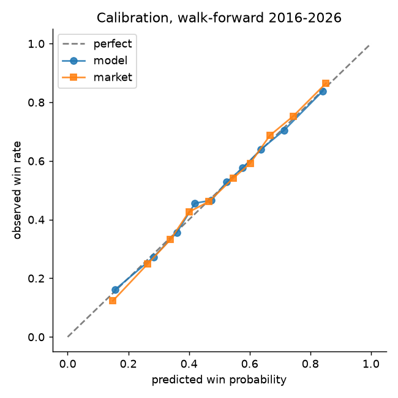
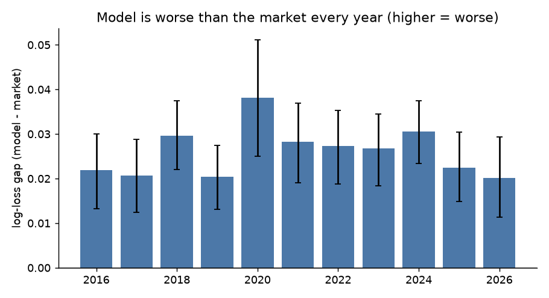
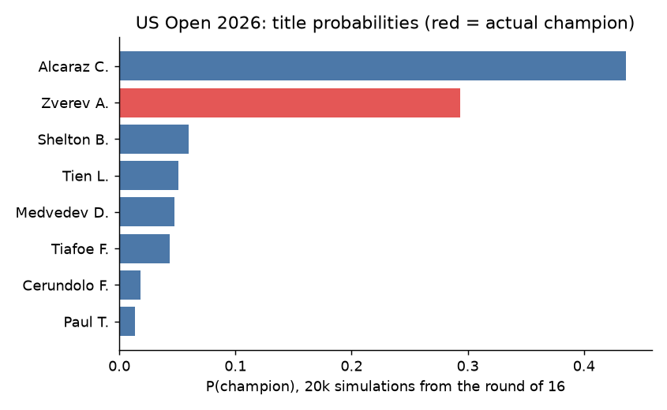

# US Open Match & Tournament Prediction

Predicts ATP match outcomes and simulates the US Open bracket from the round of 16.
The goal was an **honestly evaluated** pipeline, not a headline accuracy number:
strict time-based validation, leakage tests, and comparison against bookmaker odds.

## Results (walk-forward, 2016-2026, 26,172 matches)

| | Log-loss | Brier | Accuracy |
|---|---|---|---|
| This model | 0.6109 | 0.212 | 65.8% |
| Bookmaker (margin removed) | **0.5853** | **0.201** | **68.5%** |

- **The model does not beat the market.** Gap in log-loss: 0.0255, 95% paired-bootstrap CI [0.0231, 0.0281]; the market is better in every one of the 11 test years.
- US Open only (1,320 matches): model 0.5617 vs market 0.5275, gap 0.034 [0.022, 0.047].
- US Open 2026: 91/125 matches called correctly (72.8%) vs 94/125 (75.2%) for the market favorite.
- Tournament simulation (10,000 Monte Carlo runs from the round of 16, 8 US Opens): mean -log P(champion) = 1.349, vs 1.382 for an Elo-only baseline and 2.773 for a uniform guess (ln 16).





## Method

- **Ratings:** Elo with a decaying K-factor (K = k0 / (n + offset)^shape, tuned) plus surface-specific Elo. Ratings are recorded *before* each match and updated after.
- **Features (all differences between the two players):** Elo, surface Elo, log ATP rank, Elo x best-of-5, rest days, sets played in the last 14 days, recent form, head-to-head.
- **Model:** logistic regression without intercept on standardized features, so that p(A,B) = 1 - p(B,A) by construction. A single scalar calibration factor is fitted on the previous year.
- **Validation:** walk-forward by year (train 2006..Y-1, test Y). No random splits.
- **Leakage tests:** `tests/` flips one match outcome and checks that all earlier features and predictions are unchanged.
- **Tournament simulation:** the bracket is reconstructed from played matches (missing matches are inferred where unique); player state is frozen at the start of the round of 16.

## Things I tried that did not help

- XGBoost with mirror augmentation, monotone constraints and early stopping: 0.6098 vs 0.6081 for logistic regression on the same split.
- Boosting on the residuals of the linear model: 0.6082 vs 0.6084, no gain.
- Tuning the Elo K-schedule and starting ratings from ATP rank: no measurable gain in the final model.

## Limitations

- Does not beat bookmaker odds; the gap is largest for newcomers and early rounds, where the market likely has information the dataset lacks (injuries, Challenger results).
- One data source. The provenance and timing (opening vs closing) of the odds in the dataset are unknown, so the market is a strong but not perfectly characterized benchmark.
- Feature-set and model-family choices were made while looking at 2015+ data, so the 2016-2026 numbers are not a pristine holdout.
- Players are identified by "Surname I." strings; rare collisions are possible.
- Hypothetical future pairs use head-to-head = 0.

## Reproduce

```bash
python -m venv .venv && source .venv/bin/activate
pip install -r
